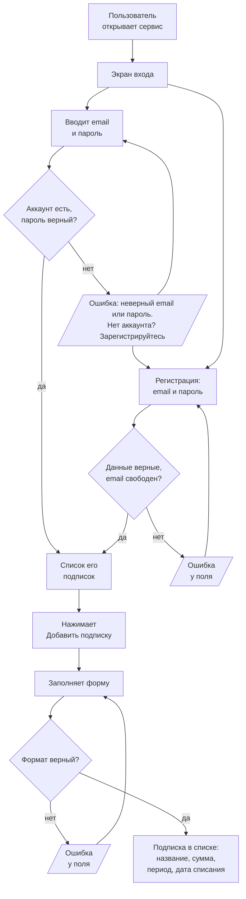

# Основной пользовательский сценарий (практика 8, часть 1, шаг 1)

## Кто пользуется и что хочет

Человек, который платит за несколько подписок (стриминг, облако, спортзал) и хочет видеть их в одном месте.

**Задача:** войти в сервис и добавить подписку.
**Результат, который он должен увидеть:** свой список подписок, в нём новая: название, сумма, период оплаты и дата ближайшего списания. Всё нужное видно в списке, отдельная страница подписки не нужна.

## Блок-схема

Сервер не различает «нет такого email» и «неверный пароль» (в обоих случаях 401), поэтому сообщение одно, с подсказкой зарегистрироваться.

## Какие состояния показывает интерфейс (детали вне схемы)

| Шаг | Состояния |
|---|---|
| Вход и регистрация | исходное, ошибки полей, отправка, ошибка сервера |
| Список | загрузка, пусто, есть записи, ошибка загрузки |
| Форма добавления | исходное, ошибки полей, сохранение, ошибка сервера, успех |

Поведение каждого шага описано в `spec.md`, внешний вид будет в макете (следующий шаг).
