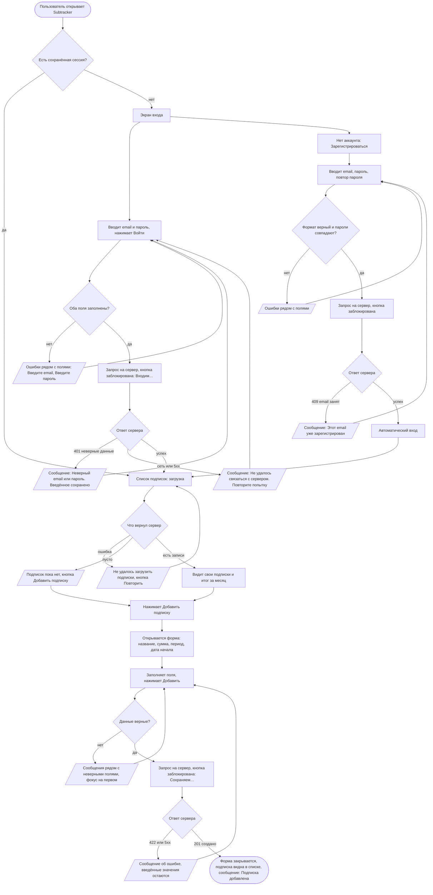

# Основной пользовательский сценарий (практика 8, часть 1, шаг 1)

## Кто пользуется и что хочет

Человек, который платит за несколько подписок (стриминг, облако, спортзал) и хочет видеть их в одном месте и знать, сколько они стоят в месяц.

**Задача:** войти в сервис и добавить подписку.
**Результат, который он должен увидеть:** новая подписка появилась в списке с названием, суммой, периодом оплаты и датой ближайшего списания.

## Блок-схема

## Где и какие состояния показывает интерфейс

| Шаг | Состояния |
|---|---|
| Вход и регистрация | исходное, ошибки полей, отправка, ошибка сервера (401, 409, сеть) |
| Список | загрузка, пусто, есть записи, ошибка загрузки |
| Форма добавления | исходное, ошибки полей, сохранение, ошибка сервера, успех |

Поведение каждого шага описано в `spec.md`, внешний вид будет в макете (следующий шаг).
